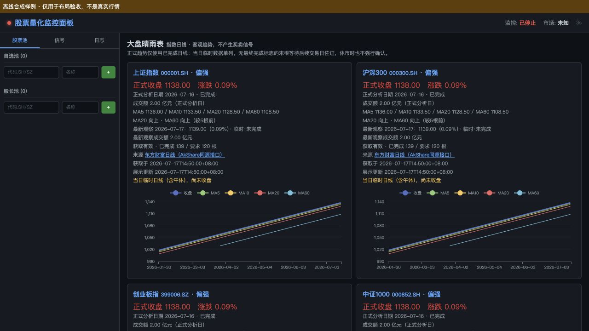

# P1-01：大盘指数基础分析报告

日期：2026-10-19，Asia/Shanghai。前置阅读了P0-01、P0-02、P0-03-1、P0-04-1、P0-04-2、P0-04-2B、P0-04-2C、P0-04-3及测试精简整理报告，并检查了当前主扫描、分钟行情、质量侧车、原Flask页面和测试入口。

## 1. 交付结论与真实验证边界

已在原Python + Flask项目中实现四指数日线适配器、独立本地缓存、MA与基础趋势分析，并在原首页增加大盘晴雨表。无第二后端、前端工程、全市场扫描、广度、板块轮动、筹码、交易信号、仓位或下单功能。

- 新增32项离线测试全部通过；日常回归237项全部通过。
- 原9项算法问题仍以普通失败保留，已知缺陷入口退出1，没有改断言或跳过。
- 四个指数的**初次公开接口请求实际成功**，身份、市场、名称匹配，各返回432行；不是根据代码前缀猜测指数。
- **后续用新增生产适配器复核时四次均遇到ProxyError/RemoteDisconnected**。包含原成功参数的有限复查也失败。因此不能声称数据链路已经稳定，或新增适配器已完成真实端到端成功验收。当前交付是可运行实现、离线验证和如实记录的接口联调限制，不是稳定实盘认证。

没有将初次请求的末行片段或合成样本补成真实历史缓存；真实联调失败时应在页面看到不可用/降级提示。

## 2. 数据源选择及核验依据

### 2.1 依赖与选择

现有quant环境：AkShare 1.18.91、PyTDX 1.72、requests 2.34.2、Flask 3.1.3。查验了本地AkShare的`index_zh_a_hist`、`stock_zh_index_daily_em`实现。

采用东方财富明确日频的公开K线接口，与AkShare上述接口同源。直接使用一个小型requests适配器，原因是现有AkShare包装没有显式请求超时，通用包装还可能获取全指数代码映射。此处只支持四个已核验secid，禁止探测其他股票代码或静默自动切源。

一手参考：

- [AkShare指数官方文档：历史日线、字段及量额单位](https://akshare.akfamily.xyz/data/index/index.html#id10)。
- [AkShare上游指数适配源码](https://github.com/akfamily/akshare/blob/main/akshare/index/index_stock_zh.py)。
- [PyTDX标准行情文档](https://pytdx-docs.readthedocs.io/zh-cn/latest/pytdx_hq/)。PyTDX作为现有依赖检查，未接入本期日线主源，未改变其分钟收盘契约。

请求固定`klt=101`、`fqt=0`，获取指数原始点位，非个股前复权。连接超时3秒、读取超时8秒。默认请求最近550个自然日，不以自然日数量冒充交易日数量。均线使用真实返回、校验后的已完成交易日记录。

| 页面标识 | 指数名称 | 东方财富secid | 实际返回market | 初次返回行数 |
| --- | --- | --- | --- | --- |
| 000001.SH | 上证指数 | 1.000001 | 1 | 432 |
| 000300.SH | 沪深300 | 1.000300 | 1 | 432 |
| 399006.SZ | 创业板指 | 0.399006 | 0 | 432 |
| 000852.SH | 中证1000 | 1.000852 | 1 | 432 |

`.SH/.SZ`在此表达该行情发布市场，不是说中证指数只覆盖该交易所股票。每次响应再次校验code、market、name；身份不符即拒绝。接口字段f51—f57依次为日期、开、收、高、低、量、额；内部分开命名为OHLCV与amount，量为手、额为元，不把成交量改名成交额。

实际请求结果摘要及失败复核见[real_source_validation.json](P1-01_evidence/real_source_validation.json)。初次探测只留下工具实际输出的身份、行数和原始末行，没有完整响应或逐请求精确时间；未补造缺失证据。末行数据为当次观察值，不代表最终收盘。

### 2.2 完成状态与因果边界

该日线接口没有最终完成标志。采用显式、保守的日线分析契约：

| 情况 | 状态及处理 |
| --- | --- |
| 明确交易日当日09:30至15:00之前，含午休 | forming，显示临时值，不用于正式均线/趋势 |
| 日期早于观察日；本次日频响应中已取得更晚的明确交易日记录；目标交易日历有覆盖 | closed，可用于对应日期的日线分析 |
| 末根即便已过15:00、周末或假期 | unknown，无最终标志/后续记录时不强行完成 |
| 日历缺失、冲突、非交易日、获取时间超前 | unknown；正式数据不足或质量警告 |
| 未来日期 | 来源刷新整批拒绝；纯分析回放排除未来行并提示，不用其值计算 |

这里的closed表示**该日交易时段已结束且有明确日频后续记录佐证**，不是供应商历史数据永不修订的承诺。该规则不移植给PyTDX分钟行情，不改变P0的unknown/confirmed政策，也不输出任何confirmed交易事件。

这是有意的保守滞后：收盘后当天末根可能直到下一交易日出现日线记录才能用于正式趋势；周末可能仍显示周四正式结论、周五未知末根。页面同时显示最新观察值和正式分析日期，不能隐藏这种差异。

完成证据以本次实际取得响应为前提，不把之后看到的记录回填成过去当时已确认。当前仅输出最新正式趋势与向后滚动的历史MA曲线，没有历史买卖标记或事后改写历史趋势记录的功能。日线数据源历史更正仍可能改变重算MA；本阶段没有做不可变日线观察账本或收益回测。

## 3. 新增和修改文件

| 文件及关键位置 | 内容 |
| --- | --- |
| `index_market.py:39`（新增） | 四指数明确映射、集中IndexSettings |
| `index_market.py:70`、`:101` | 严格日线校验、单源超时适配器 |
| `index_market.py:142` | 日线完成状态，复用P0只读交易日历和时区工具 |
| `index_market.py:172`、`:179`、`:187`、`:197` | MA、方向、趋势和分析结果，各自独立函数 |
| `index_market.py:247` | 懒加载服务、缓存、失败降级和逐指数同步 |
| `webapp/app.py:14`、`:22`、`:30` | 兼容原脚本/模块启动，项目根路径、可选QUANT_BASE_PATH、懒加载服务 |
| `webapp/app.py:160`、`:165` | 指数清单与单指数GET API，原路由保留 |
| `webapp/templates/index.html:102`、`:131` | 原首页增加卡片、独立刷新及ECharts均线图 |
| `webapp/templates/index.html:335`附近 | 原股票图表写入stockContent，避免覆盖新增大盘区域 |
| `requirements.txt` | 补上原Web本就需要但漏声明的Flask；未安装或升级依赖 |
| `tests/test_index_market.py`（新增） | 32项离线测试 |
| 本报告与`P1-01_evidence/` | 真实请求摘要、离线结果摘要和布局截图 |

`BASE_PATH`由写死Linux路径改为源码所在项目根目录，可用`QUANT_BASE_PATH`显式指定旧部署位置。这是保证当前原页面及指数缓存可在macOS运行的最小兼容改动；没有重构原股票池、日志解析、自有MACD/KDJ或写接口。

未修改`main.py`、`strategy.py`、`shared_data_fetcher.py`、`market_data_state.py`、`signal_policy.py`、`seal_monitor.py`、原缺陷测试及清单。它们与本阶段开始时的SHA-256核对一致。工作区已有P0差异未回退。真实分钟CSV没有读取、覆盖或迁移。

## 4. 指数分析规则

所有正式计算只接收已完成日线，使用当时及以前收盘价：

- MA5/10/20/60为对应最近N个交易日收盘价的简单均值，满N根才有值，不用居中窗口、负shift或后续价格补值。
- 涨跌幅为`(本分析日收盘/上一已完成交易日收盘 - 1) × 100%`。
- 成交额是对应正式分析日的真实amount；页面以亿元展示，API原值为元。
- MA方向默认比较5根前：`(MA[t] - MA[t-5])/5`，大于0向上、小于0向下、等于0持平，缺值未知。这里只是点位/根斜率，不做收益预测。
- 正式趋势要求至少120根已完成记录，同时最近所需120根区间内日历完整、无应有交易日缺失。即使已有MA60，未满预热仍显示数据不足。

| 结论 | 全部条件 |
| --- | --- |
| 偏强 | 收盘 > MA20 > MA60，MA20和MA60均向上 |
| 偏弱 | 收盘 < MA20 < MA60，MA20和MA60均向下 |
| 震荡 | 数据充分，但不满足上述任一组；含等号及方向混合 |
| 数据不足 | 预热不足、MA/方向未知、近期缺日/日历不足或异常记录等 |

MA5和MA10先用于客观展示，不额外叠加交易规则。fresh/stale/unavailable/unknown与趋势结论分开；过期缓存可以显示它在对应历史日期的趋势，但必须同时显示降级提示，不能解释成当前市场结论。

校验拒绝空数据、非日线时间戳、非法日期、缺字段、NaN/Inf、负量额、布尔伪数值及OHLC冲突。乱序统一排序；完全相同的重复折叠，同日不同数值的重复拒绝。请求固定日频、缓存声明1D，同时用近期交易日连续性识别缺日/误传周频，不能单靠相邻日期猜原始来源频率。

## 5. Web展示及性能

原首页顶部新增“大盘晴雨表”，原股票池、信号、日志、股票K线和指标区保留。四张卡片展示正式收盘/涨跌/成交额、MA5/10/20/60、MA20/60方向、最新临时值及状态、正式日期、获取时刻和展示时刻、来源、有效根数及错误。近期图使用最多120根已完成日线的收盘和MA曲线，不把临时值接入正式MA。

沿用原深色样式和现有ECharts CDN，窄屏卡片单列。页面用转义后的文本展示来源错误；图表库失败时保留数值及明确提示。未整体重设计。

浏览器实际验看了原Flask页面和四张图表。预览使用临时目录、注入时钟及明确的合成夹具，顶部醒目标注“离线合成样例 · 仅用于布局验收，不是真实行情”。原Flask仅临时绑定本机8090，已停止，预览标签已关闭；不是另建服务或真实后台扫描。



缓存位置与分钟完全隔离：

```text
runtime/index_daily/000001.SH.json
runtime/index_daily/000300.SH.json
runtime/index_daily/399006.SZ.json
runtime/index_daily/000852.SH.json
```

每份JSON带schema、代码/市场/名称、source、frequency、原始点位口径、量额单位、fetched_at和完整返回行。内存与磁盘缓存复用；写同目录临时文件、flush/fsync、验证后replace，异常不破坏旧文件，不将残留tmp作为正式缓存。该能力没有触碰P0八列分钟协议。

默认交易/午休或时段未知时5分钟有效；盘前、收盘后和休市6小时。日期或交易阶段改变立即过期，避免盘后继续误用盘中版本；失败重试至少间隔60秒。页面每60秒更新大盘区，原股票状态刷新维持原节奏；无强制刷新绕过缓存入口。

请求成功但最新交易日期滞后，仍为stale；无日历不能证明新鲜为unknown；无有效缓存且接口失败为unavailable。历史日期在休市不会单因“不是今天”就过期，按明确交易日历找应有最新日期。休市末根完成状态仍单独处理，不等于故障。

服务在首次指数API请求时建立，无启动扫描或定时后台线程；四指数单独GET并发加载，各自锁定，不持有主分钟行情或通知锁。网络请求只会等待对应Web请求，不调用main或封单监控。部署若使用单线程WSGI，慢请求仍可能占据该Web工作线程，应使用原Flask默认多线程或合适WSGI配置；本阶段不提供新的部署服务。缓存仅进程内协调，不宣称多worker共享抓取去重或完备多进程一致性。

## 6. 测试结果

统一使用现有quant环境，未安装/修改环境；所有自动单元测试均离线合成样本，真实请求不计入通过数量。结果摘要见[test_results.txt](P1-01_evidence/test_results.txt)。

| 运行 | 实际结果 |
| --- | --- |
| 新增指数测试 | 32通过，0.226秒，无失败/错误/跳过 |
| `run_tests.py regression` | **237通过，12.266秒，退出0** |
| `run_tests.py known` | **9项普通失败，2.894秒，退出1**；无错误/跳过 |
| 内联JavaScript语法 | node --check退出0 |

日常测试由原205项加32项组成；全量为246个不同测试，不重复累加阶段运行。新测试包括映射、请求字段/超时/响应释放、OHLCV校验、排序重复冲突、四MA独立算术参考、斜率及趋势正反例、预热不足、午休/收盘/跨日/未知日历、未来数据与时间回退、缺交易日、前缀计算、缓存复用/过期/恢复/原子失败、错误身份缓存、单指数故障隔离、Flask首页和新旧只读路由。

原9项依旧为B/S重绘、柱内/综合背离重绘、BACKSET、np.roll边界以及ZIG的3项语义问题。原`tests/test_signal_causality.py`指纹保持`bd0a671bc8e7a0f63ea62095e3fd0616af60be31e31fba4b4b776ab324f3ddcb`，没有删除、跳过、修改预期或把新失败加入已知清单。

项目根目录复现：

```bash
/opt/miniconda3/envs/quant/bin/python -B run_tests.py regression
/opt/miniconda3/envs/quant/bin/python -B run_tests.py known
```

第一条应退出0，第二条当前应以9项普通失败退出1。离线测试不监听端口、不请求行情；浏览器预览是单独的有界布局验收，真实源验证又单独记录，三者没有混淆。

启动原Web（本阶段交付时没有留下常驻服务）：

```bash
cd /Users/wind/Desktop/QuantTrading-gu && /opt/miniconda3/envs/quant/bin/python -B -m webapp.app
```

浏览器访问本机8090即可；原入口仍绑定0.0.0.0，继承的鉴权/写接口安全问题未在本阶段修复，勿直接暴露公网。不会自动启动main或真实通知。

## 7. 限制与P1-02复用能力

尚未解决：

1. 网络/代理在真实复核中中断；没有证据保证公开接口SLA、持续可达或主源适配器实际端到端稳定，需后续部署环境有限只读复验。未绕过代理、订购数据或增加复杂自动切源。
2. 最后一根没有可靠最终发布标志，会保守滞后；需要来源最终发布协议或可靠正式日终数据，才能合理提前使用当日收盘，不能靠到点升级。
3. 复用本地交易日历，只读并尊重缺失/冲突；没有联网认证或补写未来年度日历。覆盖不足时正式分析受限。
4. 公开历史数据可能更正；没有持久化不可变日线观察快照、历史趋势档案、逐时点回测数据集或更正审批。没有声称已经回测或预测市场。
5. 缓存无复杂增量分页、多进程抓取协调或自动备用源；32项离线通过不代表跨网络、部署及长期负载均完成验收。
6. 原9项算法问题、旧Flask的日志信号“买入/卖出”文案、自有指标口径、鉴权等仍保留，不能把大盘模块的描述性结论解释成原策略已修复或获准交易。

P1-02可复用：明确指数身份、独立日线schema/单位和超时接口、严格校验、日历/完成状态边界、缓存失败降级、纯MA与趋势函数、原Flask API和ECharts卡片、可注入时间/数据源的测试夹具。本期没有提前接入全A成分、涨跌家数或行业轮动。

本阶段完成后停止，等待验收；真实适配器联调限制如上保留。
