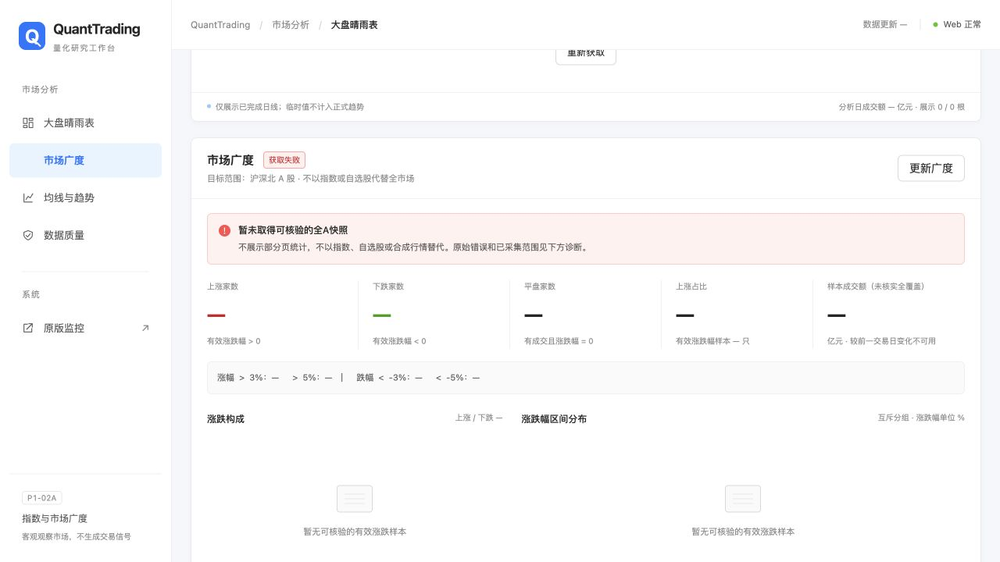
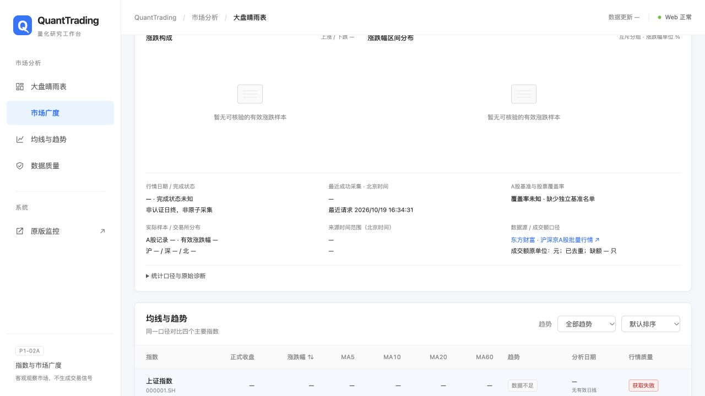
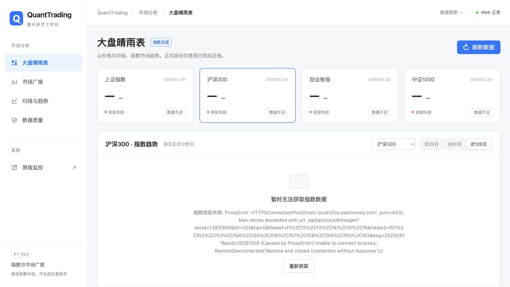

# P1-02A：全A市场广度第一阶段报告

日期：2026-10-19，北京时间。开发前已阅读P1-01及P1-UI-01报告。本期仅增加批量行情广度计算、独立缓存及8091浅色Dashboard展示，不包含MA20比例、市场综合评分、板块轮动或交易功能。

## 1. 结论与验收边界

代码实现和离线回归完成；**真实全市场数据验收尚未通过**。有限次真实探测中，东方财富、腾讯、新浪的首页曾成功，但完整获取复核遇到代理断连/响应异常，不能用首页推断全A结果。正式页面显示获取失败、统计值为“—”，没有填入模拟数据或部分页涨跌统计。

- 东方财富首页返回100条证券记录，来源声明总数5924；这不是已独立核验的5924只A股。
- 腾讯首页返回200条，来源声明5575；新浪首页返回80条，本次响应没有全量总数。
- **通过完整获取与校验的正式快照：0份。正式有效A股样本数、交易日及股票覆盖率目前不可用**，不是上涨数/下跌数等于0。
- 无独立、同日的沪深北A股基准名单，即使分页完整也只发布“返回A股样本”统计，覆盖率未知，不声称100%覆盖或将样本成交额叫作全A成交额。

## 2. 真实接口探测与选择

探测均为有限、只读的批量请求，没有逐股请求数千次，没有调用真实通知或main扫描。采样摘要见[P1-02A_evidence/source_probe_summary.json](P1-02A_evidence/source_probe_summary.json)。该文件是实际工具结果的摘要，不冒充完整原始响应归档。

| 来源与接口 | 真实时间（北京时间） | 实际结果 | 不直接投入全量统计的原因 |
| --- | --- | --- | --- |
| 东方财富 `82.push2.eastmoney.com/api/qt/clist/get` | 16:12:18.381–18.956 | HTTP200；首页100条；声明5924；样例含920992、920985北交所股票 | 仅首页，未完成全量及独立身份核验 |
| 腾讯 `proxy.finance.qq.com/cgi/cgi-bin/rank/hs/getBoardRankList` | 16:12:18.381–18.765 | HTTP200；首页200条；声明5575 | 样例无可核验日期时间；成交额单位及沪深北完整范围未验证 |
| 新浪 `vip.stock.finance.sina.com.cn/quotes_service/api/json_v2.php/Market_Center.getHQNodeData` | 16:12:18.382–18.959 | HTTP200；首页80条；含bj920000、bj920001 | 只有ticktime，无完整交易日期；未完成全量 |
| 东方财富大页请求 `pz=10000` | 16:13:52起 | ProxyError / RemoteDisconnected | 不以大页参数成功返回全量作假设 |
| 腾讯大页请求 `count=6000` | 16:13:52起 | 响应缺少data，不能确认完整范围 | 不自动拼入另一来源 |
| 新生产适配器完整获取 | 16:21:59.838–16:22:00.207 | 第1页ProxyError；未接受任何完整快照 | 无正式stats；失败留痕 |
| 重启8091后实际页面调用 | 16:34:31.204起 | 第1页再次ProxyError | 截图如实展示不可用 |

选择东方财富作为**单一主适配器**，理由是已验证首页结构含代码、市场、昨收、涨跌幅、成交量、成交额及f124时间字段，并有现有AkShare适配代码可核对。没有实现复杂备用切换，也不混合不同源/不同时点。

主接口参数：`pn`分页、`pz=100`、`po=1`、`np=1`、`fltt=2`、`invt=2`、`fid=f12`；范围`m:0 t:6,m:0 t:80,m:1 t:2,m:1 t:23,m:0 t:81 s:2048`；字段`f2,f3,f5,f6,f12,f13,f14,f18,f124`。不使用AkShare包装器内的多次重试/随机延时来占用Web请求线程，直接设置有界超时。

字段口径：f2最新价、f3涨跌幅（百分数点，3代表3%）、f5成交量（手）、f6成交额（元）、f12证券代码、f13来源市场标识、f14名称、f18昨收。f124按秒级epoch转换为北京时间。**f124只作为来源更新时间证据，不当作交易所认证的成交时刻或日终完成标志。** 行情所属日期取来源时间日期并核对本地交易日历；日期一致仍不等于已认证日终。

参考：[AkShare股票接口文档](https://akshare.akfamily.xyz/data/stock/stock.html)、[腾讯适配源码](https://raw.githubusercontent.com/akfamily/akshare/main/akshare/stock/stock_zh_a_tx.py)、[新浪适配源码](https://github.com/akfamily/akshare/blob/main/akshare/stock/stock_zh_a_sina.py)、[北交所代码映射](https://www.bse.cn/service/code_mapping.html)。真实接口结果优先于包装器名称，接口总数差异不解释为同口径完整覆盖。

## 3. 统计和异常口径

### 身份、去重与成交额

范围为沪、深、北A股，和个股选股池排除北交所的历史要求不同：本期用户明确要求全A包含北交所。ST及新上市股不因名称被排除。

来源证券筛选范围 + 明确交易所标识 + A股代码白名单共同校验：沪600/601/603/605/688；深000/001/002/003/300/301；北920。ETF、基金、B股、指数和未支持身份不计入；689存托凭证不混入本口径。北交所旧43/83/87代码不凭前缀直接纳入，以免误计新三板；后续需要官方映射及基准名单补齐验证。这不是永久不变的证券主数据规则。

按`代码.交易所`去重；完全相同行只算一次，重复身份但字段冲突则拒绝快照。去重后统一成交额为元，Decimal求和，前端仅转换为亿元。缺失成交额不补0；同日明确停牌但已有成交的有效成交额可以保留，旧日期停牌记录的非零累计额不混入当日金额。只有基准完整匹配且金额完整等条件满足才输出`all_a_amount_cny`，否则只输出带明确标签的样本成交额。

### 涨跌统计

- 有效涨跌幅>0上涨、<0下跌、=0平盘；上涨占比=上涨/有效涨跌幅样本数。
- 明确停牌、量额都为0的无成交、缺有效昨收、缺涨跌幅、价格/成交活动冲突及涨跌幅与昨收明显不一致，分原因排除，不当平盘。
- 不确定停牌不编造停牌标记。当前主接口没有已核验停牌字段，`suspended=None`，仅能确认零成交及其他缺失；无法穷尽识别各种停牌状态。
- 涨跌幅与`(最新价/昨收-1)*100`交叉校验，容忍0.025个百分点舍入误差，保留来源涨跌幅，不自行覆盖它。
- 互斥分布：`<-5%`、`[-5%,-3%)`、`[-3%,0%)`、`0%`、`(0%,3%]`、`(3%,5%]`、`>5%`。分布之和等于有效样本；超过3%、5%采用严格不等式。
- 有效样本为0时不输出比例/无限涨跌比。成交额与涨跌幅有效范围分别统计并披露，不暗示两者分母相同。
- 没有两日同范围可比的可信快照，不估算较上一交易日成交额变化；当前明确不可用。

### 时间和覆盖门控

全页必须获取完成、总数一致、页长正确；分页遗漏/来源总数变化不发布部分页。默认采集窗口不超过20秒、有效活跃样本来源时间跨度不超过30秒，同一来源交易日期一致，拒绝未来时间、活跃数据时间缺失、来源日期冲突及缺交易日历证据。两项窗口阈值是可配置的工程一致性约束，不声称构造交易所原子快照。

保留来源时间最小/最大值、请求/完成时间、页信息、来源总数、去重/排除数量、沪深北分布、金额缺失数及覆盖说明。缺独立基准时不因为接口有5924条就算100%；代码提供可注入已核验基准的入口，生产默认未配置。

盘中数据标记盘中快照；当前接口无可信日终标记，盘后仍为`completion_state=unknown`。不依据系统已过15:00就升级日终完成。

## 4. 文件和架构

| 文件 | 改动 |
| --- | --- |
| `market_breadth.py`（新增） | 纯校验/归一化、身份及去重、覆盖报告、涨跌分布与金额统计；不读盘、不联网、不取系统时间 |
| `breadth_data.py`（新增） | 单源有限分页、超时与采集窗口、独立缓存、新鲜度及失败降级 |
| `webapp/app.py` | 懒加载原Flask应用扩展；新增只读GET `/api/market/breadth` |
| `webapp/templates/dashboard.html` | 8091原浅色页面增市场广度锚点及白色Card，保留四指数/主图/均线表 |
| `webapp/static/breadth.css`（新增） | 独立命名样式，沿用原Ant浅色色彩、卡片及数字层级 |
| `webapp/static/breadth.js`（新增） | 展示后端统计、ECharts构成/分布、加载及失败状态；不重算市场数据 |
| `tests/test_market_breadth.py`（新增） | 44项离线测试 |
| 本报告与`P1-02A_evidence/` | 实际探测摘要、测试摘要及真实页面截图 |

仍为Python + Flask + Jinja2 + 原生JS + ECharts；8091继续是原Flask应用的展示入口，没有独立业务后端/React/npm工程。8090根页面及原版模板未改，原四指数服务和JS未改。

`strategy.py`、`signal_policy.py`、`market_data_state.py`、`shared_data_fetcher.py`、`main.py`、`index_market.py`、`webapp/templates/index.html`与本阶段开始时SHA-256一致。没有触及分钟CSV、信号分类、封单监控、交易公式或原9项缺陷测试。工作区已有P0/P1未提交改动均保留。

## 5. 缓存与性能

新目录`runtime/market_breadth/`，与分钟和指数历史隔离：`latest.json`只保存校验通过的来源快照；`request_status.json`保存最近尝试和失败详情。采用同目录临时文件、flush/fsync、原子替换，不将临时文件视为正式缓存；失败不覆盖旧有效快照。

默认：批量每页100、最多80页、并发最多4；连接2秒、读5秒；采集窗口20秒。线程池仅为一次有限批量请求服务，无持续后台全市场扫描；超时取消尚未执行工作，正在进行请求仍受连接/读超时约束，不承诺硬实时20秒终止网络线程。

缓存TTL：交易中180秒、午休900秒、盘后1800秒、休市21600秒；交易日期/时段变化重新检查。错误后冷却180秒（重启后也读取状态），同进程刷新锁避免并发重复获取。不是每次页面刷新都下载全量。页面可见时60秒检查API，由后端决定是否过期。

新鲜度不能仅靠请求成功证明：交易中核验来源时间，午休按11:30边界，盘后及休市按最近日历交易日15:00边界检查，默认容忍180秒。休市不因距现在超过几小时就将上一交易日数据判异常；仍需验证对应交易日及午/收盘来源时间。缺日历不按工作日猜测。失败有旧快照时保留日期并标stale，无旧快照时unavailable。

广度请求在原Flask Web线程中独立处理，不获取main扫描/通知锁；Web启动仅注册懒加载服务，不自动扫描。当前锁为进程内锁，多进程Web共同部署时尚无跨进程刷新协调；暂不宣称分布式部署能力。

## 6. 实际页面验收

经用户单独授权，仅优雅停止已核验的8091 `python -B -m webapp.dashboard`进程并重启同一入口；没有停止/重启main或8090。8091保持运行供验收。

实际1280×720桌面浏览器截图，无模拟行情、无替换API。新增模块显示失败Alert、统计缺省值、图表Empty、质量信息和折叠诊断。原四指数控件仍在，实际切换至沪深300后标题、选择状态及对应接口错误均正确联动；当前指数源同样ProxyError，不能以此次截图宣称真实指数图表成功加载。







本期按既定要求仅桌面验收。正常有数据时的图表结构/数据绑定由离线测试验证，**尚无真实全A图表成功截图**，不把该项冒称真实行情验收通过。

## 7. 测试

统一环境：`/opt/miniconda3/envs/quant/bin/python`，Python3.11.15 / NumPy2.4.6 / pandas3.0.5 / Flask3.1.3。

```bash
/opt/miniconda3/envs/quant/bin/python -B run_tests.py regression
/opt/miniconda3/envs/quant/bin/python -B run_tests.py known
/usr/local/bin/node tests/dashboard_view.test.cjs
/usr/local/bin/node --check webapp/static/breadth.js
```

- 日常回归：**288项全部通过**，12.211秒；本期前244项，本期新增44项，无新增失败/跳过。
- 已知缺陷：**9项全部按原断言失败**，3.239秒，退出码1符合缺陷复现预期，未删除、跳过或放宽。
- 原Dashboard展示测试20个断言通过；新增JS语法检查通过；`git diff --check`通过。
- 新测试涵盖身份/过滤/冲突/去重、所有分布边界、缺昨收/缺涨跌幅/零成交/停牌、金额换算/缺额、日期/未来/乱序快照一致性、缺基准/可注入基准、完整分页与失败、独立缓存/原子替换/冷却/并发、午休/休市、Flask API及8090/8091和四指数兼容。

全部离线测试使用合成数据、模拟HTTP和临时目录，不连接行情服务器；与上文真实探测严格区分。测试运行没有启动main、推送或订单。

## 8. 尚存问题与后续可复用能力

1. 网络代理断连导致无法交付可信全市场统计，必须在网络恢复后重新做有限的真实全页取数验收；不靠放宽质量阈值解决。
2. 还没有独立沪深北同日股票基准名单及历史代码映射，覆盖率未知。页总数不是基准；ST、新股等范围也需基准进一步对齐。
3. 来源停牌标记和日终最终完成标记未验证，f124为来源时间，不足以认证交易所日终；明确保持未知。
4. 多页排序过程不是原子快照，严格校验会拒绝总数变化、冲突及时间差过大的数据。可能牺牲可用性，但不拼造市场结论。
5. 没有可比两日完整快照，成交额较前日变化暂不可用；没有历史市场广度回填/回测。
6. 后续可复用纯广度计算、身份校验、覆盖报告、时间/缓存门控、只读API及浅色UI区域。未提前实现MA20广度、综合市场评分或任何策略计划。

本阶段开发到此停止，等待验收。数据链路限制如上，不承诺已实现稳定的真实全A行情服务。
