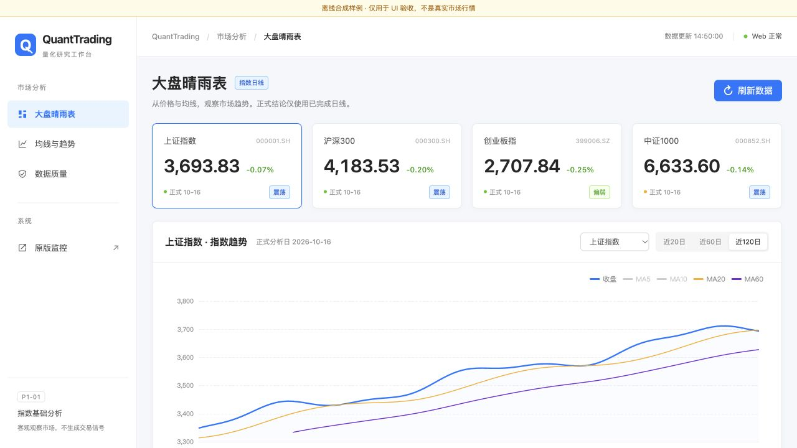
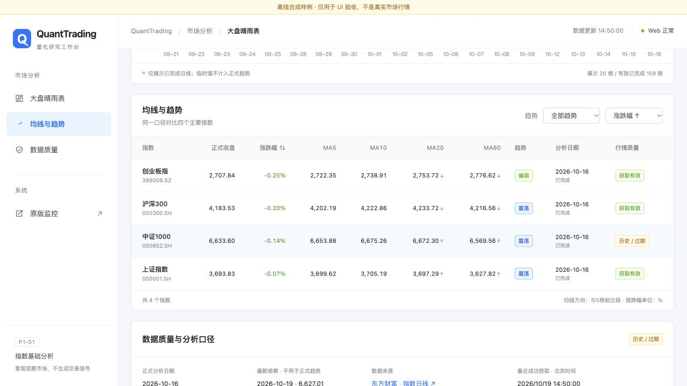

# P1-UI-01：Ant Design 浅色 Dashboard 桌面验收报告

日期：2026-10-19（Asia/Shanghai）。按用户最后要求，本期**仅做桌面端**，不做移动端适配或移动端截图。不提前开发P1-02及后续业务。

## 1. 交付范围

8091新增浅色量化分析界面，8090继续保留原页面。新版只消费已有P1-01指数API及系统状态接口；没有新增业务数据接口、计算模块、交易规则或独立业务后端，也没有引入React、npm工程或Ant Design React运行依赖。

采用用户指定的Light Theme令牌：品牌蓝`#1677FF`、页面背景`#F5F7FA`、白色Card、文字`#262626`/`#8C8C8C`、分割线`#F0F0F0`、上涨`#CF1322`、下跌`#389E0D`。只参考Ant Design的视觉语言，不冒称使用其React组件。

参考了[Ant Design布局规范](https://ant.design/docs/spec/layout/)和[主题令牌说明](https://ant.design/docs/react/customize-theme/)。官网当前默认展示更新版本，本期实际实现以用户指定的Ant Design 5 / Pro浅色风格和颜色为准，不升级框架或依赖。

### 页面组织

- 220px固定白色侧栏：大盘晴雨表、均线与趋势、数据质量锚点及8090原版链接。没有放置未开发的广度、筹码、板块等菜单。
- 白色Header：QuantTrading、当前页面、最近成功获取时间、Web可用状态；Web正常不等于行情新鲜，状态悬停说明与数据质量独立。
- 浅灰内容区、约24px间距、白色8px圆角Card、浅色边框及轻微阴影，无暗色主题、霓虹或渐变大屏效果。
- 顶部四指数Statistic卡片；中部单张主趋势图；下方统一均线Table及数据质量说明，不将每个字段拆成独立小卡。
- 原始指数值、涨跌幅、MA5/10/20/60、MA20/60方向和趋势均直接展示现有API值；只做数字格式化、元转亿元、表格排序与筛选，不在前端重新计算指标。
- 主图支持四指数切换和近20/60/120根展示；收盘、MA20、MA60默认显示，MA5/MA10可通过图例启用。
- 表格数字右对齐，支持趋势筛选、涨跌幅升降序，点击指数名称与统计卡或下拉选择均可联动同一图表及质量信息。

桌面最小布局宽度1100px，已在实际1280×720浏览器画面验看。不承诺手机布局或未经测试的各种分辨率均完成验收。

## 2. 双端口与文件清单

```text
8090 / ────────────────→ 原 webapp/app.py 的 index.html
8091 / → 薄WSGI路径映射 → 同一Flask app 的 /dashboard
                         └→ dashboard.html + 独立CSS/JS
两端口的 /api/* ────────→ 现有Flask路由和原IndexMarketService
```

新增`webapp/dashboard.py`仅将8091根路径映射到`/dashboard`，不会修改原Flask应用的WSGI对象或8090根路径。运行时不启动行情扫描、通知或其他后台业务。单独启动两端口时是两个Web进程，但业务代码和API实现没有复制；现有指数缓存机制原样保留，未增加跨进程缓存协调能力。

| 文件 | 修改内容 |
| --- | --- |
| `webapp/app.py` | 仅增加`/dashboard`模板展示路由，传入现有四指数元数据 |
| `webapp/dashboard.py` | 新增8091本机展示入口，复用原Flask app |
| `webapp/templates/dashboard.html` | 新增桌面浅色模板、语义化控件、状态容器 |
| `webapp/static/dashboard.css` | 独立浅色主题及桌面布局；不覆盖原版样式 |
| `webapp/static/dashboard.js` | 现有API请求、视图联动、排序筛选和状态呈现，无业务指标计算 |
| `tests/test_dashboard_ui.py` | 7项离线WSGI与展示契约回归 |
| `tests/dashboard_view.test.cjs` | Node内置assert执行20项纯展示断言，无npm依赖，不进入Python测试发现 |
| `tests/preview_dashboard.py` | 有界、手动、明确标注的离线合成样例预览工具，不随Web生产启动 |
| 本报告及`P1-UI-01_evidence/` | 桌面截图与结果摘要 |

未修改原`webapp/templates/index.html`。本阶段前后SHA-256相同：

```text
原页面 index.html
ae404497425c8dc6f1900880550a49eaeeea367da2955543a13a29c13e0bf92a
index_market.py
49b6b083c71167604a79cc34f19ac2c0dbdc82faf19d7e8c822775afcac26d81
strategy.py
7f7c7ae092d5db7c6cc0c08691eae780474b4b8b9c0fc27398081279b8b6cd35
shared_data_fetcher.py
729cd56b88212e6b85317afbdc67002013766b0bd1925d7bd8c2e0a9180cf68b
signal_policy.py
0a91c2d53e95a18d7a24ad7fe58b07183e18493d1d3083da9b3148a51ec4c9db
```

`main.py`与`market_data_state.py`也与实施前一致。没有改真实配置、行情缓存、技术算法或9项已知缺陷断言。原工作区已有的P0/P1差异继续保留，没有把它们当成本次变更或回退。

## 3. 状态与交互验收

| 状态/操作 | 实现及检查 |
| --- | --- |
| 首次加载 | Statistic和主图Skeleton；切换到未返回的指数先清空其他指数图表/质量信息，避免错配 |
| 获取失败 | 空值为“—”；Empty图表和重新获取入口；红色Alert具体说明，不制造替代行情 |
| 历史过期 | 橙色Tag、主图“历史参考”、质量Alert同时提示对应历史日期；保留旧值不冒称实时 |
| 数据不足 | 仍可显示已有数值，但趋势为“数据不足”，标明有效根数/要求，不在UI升级结论 |
| 完成状态未知 | 单独显示未知/临时；正式分析日期与最新观察分列，不将临时价格拼进正式曲线 |
| 四指数切换 | 实际点击上证、沪深300、创业板、中证1000，验证标题、选择框、图表及最新观察联动 |
| 图表范围 | 实际切换20根，显示根数同步；120根数据来自既有API，不下载或重算额外历史 |
| 表格筛选 | 实际选择偏弱，只显示1个匹配指数；恢复全部后四指数返回 |
| 排序 | 实际选择涨跌幅升序，顺序为-0.25%、-0.20%、-0.14%、-0.07%的离线样例 |
| 原页面兼容 | 浏览器访问8090仍为原版监控面板；WSGI测试原首页、新旧API和薄入口均通过 |

这些交互使用测试数据验证展示调用路径，**不是当前真实指数行情联调成功的证明**。上一阶段的数据源网络限制没有在本期修复，也没有为了界面效果修改数据计算模块。

请求失败时前端可以保留上次页面结果，但明确标记为降级，并保留原成功获取时间；不会用当前刷新时间伪造数据更新。顶部时间是所有指数中最近一次成功获取时间，逐指数时间在所选质量区域显示。刷新按钮和60秒页面刷新仍遵守原服务缓存，不提供强制下载绕过接口。

## 4. 实际桌面截图

以下均为**真实浏览器渲染的离线合成样例截图，不是真实市场数据或设计稿**。新版截图顶部可见样例标识。没有生成移动端截图。

### 浅色总览



### 均线表格与涨跌幅排序



### 其他状态证据

- [历史过期与数据质量Alert截图](P1-UI-01_evidence/desktop_quality.jpg)。
- [获取失败、Empty与重试入口截图](P1-UI-01_evidence/desktop_unavailable.jpg)。
- [8090原版布局截图](P1-UI-01_evidence/legacy_8090.jpg)：同样是测试预览返回，不应当作真实行情；原模板未改，仍显示旧深色界面。

截图分区展示1280×720实际桌面视口，没有裁拼成假页面。截图后仅补充了图表底部成交额文案、最新观察涨跌幅及表头ARIA排序属性；这三处小改动经过语法/展示断言复核，不影响截图所示布局，但截图并非后续这些文字的逐像素快照。

## 5. 测试结果

环境沿用现有quant：Python3.11.15、NumPy2.4.6、pandas3.0.5、Flask3.1.3。没有安装任何前端/生产依赖。

| 检查 | 实际结果 |
| --- | --- |
| 新增Flask/WSGI测试 | 7项全部通过，0.012秒 |
| 日常回归 | **244项全部通过，11.932秒，退出0**（原237+7） |
| 已知缺陷 | **原9项普通断言失败，2.916秒，退出1**；无删除、跳过或放宽 |
| 纯前端展示断言 | 20项全部通过 |
| JavaScript语法 | node --check通过 |
| 原模板/算法/计算/缓存文件指纹 | 与阶段开始时一致 |
| git diff --check | 通过 |

Python离线测试不连接真实数据源、不启动端口或后台扫描；Node只运行格式化、转义、状态映射、北京时间及排序筛选函数。浏览器预览独立手动启动，绑定本机8090/8091，有300秒自动退出限制。提前停止请求的自动权限审核未在期限内完成，随后预览按自身期限退出；最终只读检查两端口均无监听。没有绕过审批或留下常驻服务。

预览工具的合成价格通过现有P1-01分析函数得到常规样例；不可用/过期属于显式模拟故障。测试专用`/__preview__/...`场景控制只在手动预览包装器内存在，生产入口不存在。短历史夹具已改为实际调用原分析函数处理36行，得35根完成日线及空MA60，没有修改生产计算规则。初次浏览器短历史场景只验证了展示状态，不用于认证算法数值。

## 6. 启动与复现

在项目目录分别使用两个终端：

```bash
# 原版8090（已有进程时不要重复启动）
/opt/miniconda3/envs/quant/bin/python -B -m webapp.app

# 新版8091，仅本机访问
/opt/miniconda3/envs/quant/bin/python -B -m webapp.dashboard
```

打开`http://127.0.0.1:8091/`。8090保留原页面，8091使用新模板；无需启动main，不会启动真实交易提醒。

```bash
/opt/miniconda3/envs/quant/bin/python -B run_tests.py regression
/opt/miniconda3/envs/quant/bin/python -B run_tests.py known
node tests/dashboard_view.test.cjs
```

离线样例预览（可选，非生产启动方式）：

```bash
/opt/miniconda3/envs/quant/bin/python -B tests/preview_dashboard.py --seconds 300
```

### 保留限制

1. 只实现桌面布局，用户已取消移动端要求。
2. ECharts仍依赖CDN；加载失败时保留数值和明确提示，没有新增下载/备用图表引擎。
3. 不改变P1-01的保守日线完成和网络来源限制；真实获取失败应看到Empty/Alert，而不是演示数据。生产不开放样例开关。
4. 原9项算法缺陷、原8090安全及日志展示问题不在本期修复；浅色UI不是策略可靠性、实盘部署或收益验证。
5. 只有UI与既有API契约验收，没有新增行情质量规则、全市场业务、仓位建议或交易计划。

本期停止，等待桌面UI验收。
